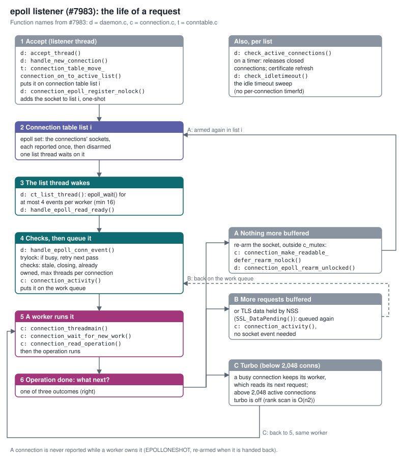
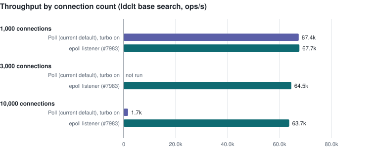
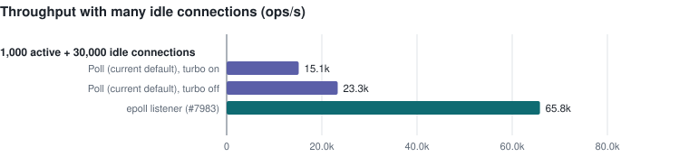
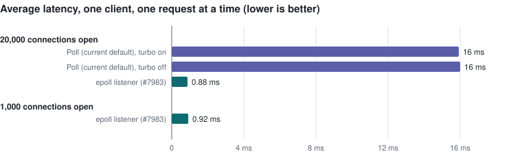
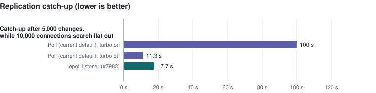

# epoll Connection Listener
---------------------------



Overview
--------

Since 3.2 the server can be built with `--enable-epoll`, which replaces the `PR_Poll()` listener with Linux `epoll` ([#6924](https://github.com/389ds/389-ds-base/pull/6924)). Each connection table list has one listener thread: it waits on the list's epoll instance and hands every ready connection to the worker threads through the global work queue.

Load testing that code showed it was slower than the default poll build at 1,000 connections, and found several correctness problems:

- Level-triggered epoll kept reporting connections that a worker already owned: 3.9 events per operation at 1,000 connections and about 125 at 10,000.
- Closed connections were never released from the active list.
- Each connection had its own timerfd for the idle timeout.
- A TLS connection whose next request was already decrypted inside NSS could stall, because no socket event arrives for it.
- The epoll accept thread did not take part in dynamic certificate refresh, a feature added after the original epoll work, so refresh hung (`tls/ecdsa_test.py::test_dynamic`).

This document describes the repaired listener in [#7983](https://github.com/389ds/389-ds-base/pull/7983) (issue [#7982](https://github.com/389ds/389-ds-base/issues/7982)). The target is C10k: throughput and latency that do not degrade as the number of connections, busy or idle, grows into the tens of thousands, while staying level with the poll build at small scale.

Use Cases
---------

- **Many concurrent clients.** Application servers and load balancers that keep thousands of LDAP connections open. With the poll build as shipped, throughput collapses at 10,000 active connections (about 1.7k ops/s against 67k at 1,000), mostly because of turbo mode's rank scan (below).
- **Many idle connections.** Connection pools that hold connections open for long periods. Every poll pass walks every open descriptor, so idle connections slow down the active ones.
- **Replication under client load.** A supplier streams changes to a consumer that is also serving a heavy search load; the consumer must keep reading the replication session.

Design
------

### Building blocks

- **One-shot events.** Connection sockets are registered with `EPOLLONESHOT`, so a ready connection is reported once and then disarmed. The worker that hands the connection back re-arms it (`EPOLL_CTL_MOD`), outside `c_mutex`. A connection is therefore never reported while a worker owns it.
- **Non-blocking listener.** The list thread only try-locks a connection's `c_mutex`; a busy connection goes on a retry list for the next pass instead of stalling the listener behind a worker.
- **No per-connection timerfd.** The existing idle sweep handles idle timeouts, and a timed pass over the active list (`check_active_connections()`) releases connections that were closed.
- **TLS data held by NSS.** When a request has been read and NSS already holds the next one decrypted (`SSL_DataPending()`), the connection is queued for work directly instead of waiting for a socket event that will not come.
- **Dynamic certificate refresh.** The epoll threads take part in the refresh rendezvous, and shutdown during a refresh is handled.
- **Bounded `epoll_wait()`.** At most 4 events per worker thread (at least 16) are taken per call, so one wake-up cannot grab more ready connections than the workers can run.
- **Turbo cut-off.** Turbo mode is used only up to 2,048 active connections (below).

### Connection flow

The life of a request with the repaired listener, with the functions that implement each step (`daemon.c`, `connection.c` and `conntable.c` in #7983):

1. **Accept.** The listener thread (`accept_thread()`) accepts the connection in `handle_new_connection()`. `connection_table_move_connection_on_to_active_list()` puts it on connection table list *i*, and `connection_epoll_register_nolock()` adds its socket to list *i*'s epoll set with `EPOLLONESHOT`.
2. **Connection table list *i*.** Its epoll set holds the connections' sockets, each reported once and then disarmed. One list thread waits on it.
3. **The list thread wakes.** `ct_list_thread()` calls `epoll_wait()` for at most 4 events per worker thread (at least 16), and `handle_epoll_read_ready()` handles them.
4. **Checks, then queue.** `handle_epoll_conn_event()` try-locks the connection (busy connections are retried on the next pass), checks it (stale event, closing, already owned, maximum threads per connection) and `connection_activity()` puts it on the work queue.
5. **A worker runs it.** A worker in `connection_threadmain()` takes it from the queue (`connection_wait_for_new_work()`), reads the request with `connection_read_operation()` and runs the operation.
6. **Operation done.** One of three outcomes:
   - **A. Nothing more buffered:** the worker re-arms the socket outside `c_mutex` (`connection_make_readable_defer_rearm_nolock()`, then `connection_epoll_rearm_unlocked()`), and the connection goes back to step 2.
   - **B. More requests already buffered, or TLS data held by NSS:** `connection_activity()` queues the connection again, without waiting for a socket event.
   - **C. Turbo mode, below 2,048 active connections:** a busy connection keeps its worker, which reads its next request itself (back to step 5).

In the background, each list thread runs `check_active_connections()` on a timer to release closed connections, and takes part in certificate refresh; `check_idletimeout()` handles idle timeouts.

### Turbo mode and the 2,048 cut-off

Turbo mode lets a busy connection keep its worker, which then waits on that one socket for the next request instead of handing the connection back. To decide which connections qualify, every 5 seconds each turbo-eligible connection's worker ranks it with `connection_find_our_rank()`, which walks every active connection under the global `table_mutex`. The cost is quadratic in the number of connections, and it is the main reason the poll build collapses at 10,000 connections: with turbo turned off, poll holds about 70k ops/s there.

#7983 keeps turbo where it helps (a client sending requests back to back on a moderate number of connections) and turns it off above 2,048 active connections (`SLAPD_EPOLL_TURBO_MAX_CONNS`). With the cut-off disabled, #7983 itself falls to 25k ops/s at 10,000 connections; with it, 62k.

### Alternatives considered

- **Keep level-triggered epoll and filter owned connections in the listener.** Rejected: the listener still wakes for every ready but owned connection, the cost that made the merged code slower than poll.
- **One epoll instance for all lists.** Rejected: every per-operation re-arm would contend on that instance's lock. The default is one list.
- **Move operation setup off the listener.** Not needed: the epoll listener uses 0.15 to 0.40 of a core at 10,000 connections, against about 1 core for the poll listener.
- **Idle workers waiting on epoll themselves (worker mode).** Removes the listener-to-worker hand-off. Prototyped and measured; see the experimental section below. On hold.

Performance
-----------

All measurements use upstream's own tools on a fixed rig: a 16 vCPU / 16 GB Fedora 44 server VM, 10 client VMs running `ldclt` (anonymous base search, closed loop), upstream `ltest.py` for latency, and default server settings. The server is restarted before every job. Throughput and replication results are the mean of two rounds; latency is one 120-sample run. Poll is the standard build as shipped (turbo on unless noted), measured on the same rig.

At 1,000 connections the builds are level. At 10,000, poll falls to about 1.7k ops/s while #7983 holds 64k, 6% below its own 1,000-connection figure. Poll was not measured at 3,000 connections.

With 30,000 idle connections open, #7983 serves 1,000 active clients at 65.8k ops/s. Poll does 15.1k with turbo on and 23.3k with turbo off: its per-pass scan of every open descriptor costs it most of its throughput.

With 20,000 connections open, a single client sees 0.88 ms per request with #7983 and about 16 ms with poll, whether or not turbo is on. #7983's latency barely changes between 1,000 and 20,000 open connections.

CPU cost per operation is flat as connections grow: about 140 µs per operation at both 1,000 and 10,000 connections (poll: 1,200 to 1,800 µs at 10,000). On this rig every build tops out at 65k to 70k ops/s with the server at about 60% CPU. The listener is not the reason: two shared locks are (next section).

### Lock contention beyond the listener

Once the listener stops being the bottleneck, off-CPU profiles show threads queued on two locks in shared code that every operation takes ([#7994](https://github.com/389ds/389-ds-base/issues/7994)):

- **Object extension lock** (`factory.c`): `factory_destroy_extension()` held the per-type `extension_lock` while running every destructor, and `factory_create_extension()` needs the same lock. The connection list thread creates every operation, so it spent most of its blocked time (76%) waiting for workers running destructors.
- **Access logging** (`log.c`, `libglobs.c`, `time.c`): every line took the config lock, the glibc time zone lock and the buffer lock, and the thread that found the buffer full wrote it to disk under that lock.

The fixes depend on each other. With one connection table list and #7983, steady load at 1,000 connections:

| Change | Searches/s |
|---|---|
| none | 65.0k |
| extension lock fixed | 73.5k (+13%) |
| access log fixed | 61.5k (-5%) |
| both | 79.6k (+22-24%) |

Fixing only the access log makes the server slower: workers that finish sooner take the extension lock more often and starve the list thread that feeds them, so idle workers more than double. With the extension lock fixed first, the list thread has spare time, the workers become the limit, and removing the access log waits pays off. With the default poll build and one list the lock waits disappear as well, but throughput does not change, because poll's single listener thread is the limit there; with four lists it is not, and the default build gains 20% (64.6k to 77.4k searches/s).

### Four connection table lists, up to 50,000 connections

Deployments with tens of thousands of connections run several connection table lists (`nsslapd-numlisteners`); four is a reasonable starting point. With four lists, mean of two 2-minute runs per point (stock configuration otherwise; see the tuning section below for what larger connection counts need):

| Searches/s, 4 lists | 1,000 | 10,000 | 30,000 | 50,000 |
|---|---|---|---|---|
| poll | 65.2k | 2.4k | not run (collapsed at 10,000) | not run |
| #7983 | 68.8k | 61.8k | 61.0k | 60.2k |
| #7984 worker mode (experimental, below) | 70.5k | 66.0k | 66.0k | 65.7k |
| #7984 worker mode with the #7994 lock fixes | 84.7k | 80.9k | 78.8k | 78.4k |

From 10,000 to 50,000 connections #7983 holds 60-62k searches/s (within 3%), about 10% below its 1,000-connection figure; poll collapses at 10,000 connections with four lists as with one. For the epoll builds the two rounds agree within 3% (5% at one point); poll at 10,000 is erratic (2.0k and 2.9k). No job left more than one connection open afterwards, and the clients stayed below 35% busy. About 63,900 connections is the most the connection table can hold (a compile-time limit; tuning section below).

### Connection churn

With a new TCP connection for every operation (connect, anonymous bind, base search, unbind, close), the server sustains about 13,000 complete connection lifecycles per second with one list and 10,600 with four, without errors once the kernel limits below are raised. The ceiling is set by the single accept thread, not by CPU (the server is mostly idle): it serialises on the connection table lock (`table_mutex`, one lock for all lists) with the list threads that retire closed connections, and new connections wait about 7 ms in the kernel's accept queue. Raising it would mean more than one accept path and a per-list connection table lock; that is not part of this work.

A stock 389ds supplier replicates `dc=repl,dc=test` (150,000 entries) to the test server. Catch-up is the time from the last of 5,000 changes written on the supplier until the consumer has them, while 10,000 client connections search flat out on the consumer. This is a deliberate stress case; full re-initialisation takes about 600 s on every build.

As shipped, poll needs about 100 s under this load, and #7983 about 18 s. Poll with turbo off is faster (about 11 s). The access logs of both servers show where the time goes: the backlog builds for the whole burst (the supplier commits about 200 changes/s, they reach the consumer at about 120/s); about half of the consumer's time per change is applying it under the search load, and about half is waiting for the supplier's next change, which pauses mid-session. Waiting for a worker is a small part.

Other results:
- LDAPS: level with poll at 1,000 connections; both builds stall at 10,000 LDAPS connections, a TLS scaling limit shared by both.
- An overnight soak (load, connection churn, five abrupt close paths, idle timeouts, certificate refresh, replication, restarts under load; 39 cycles) produced no errors, no cores and no stuck connections.

Major configuration options and enablement
------------------------------------------

- Build: `--enable-epoll` (default: no). All of this code is under `ENABLE_EPOLL`; the default build is unchanged.
- Turbo cut-off: 2,048 active connections by default; `SLAPD_EPOLL_TURBO_MAX_CONNS` in the server's environment overrides it.
- Events per `epoll_wait()`: 4 per worker thread, at least 16; `SLAPD_EPOLL_MAX_EVENTS` overrides it.
- No schema, configuration attribute or CLI changes.

### Tuning for large connection counts

None of these are changed by this work; they are what the measurements above needed beyond about 10,000 connections, and what large deployments should check.

- **Connection table lists:** `nsslapd-numlisteners` (default 1). Four or more for tens of thousands of connections.
- **Connection table size:** the table holds `nsslapd-maxdescriptors` minus the reserved descriptors, but never more than `FDS_PROCESS_MAX` (64,000, a compile-time limit in `daemon.c`) minus the reserved ones, split across the lists (4 lists: 15,975 slots each). Going past about 63,900 simultaneous connections needs a code change, not tuning.
- **File descriptors:** the server takes its limit from the service's `LimitNOFILE`; `nsslapd-maxdescriptors` only needs setting if an older configuration pins a lower value. With epoll the limit is also capped by `fs.epoll.max_user_watches` (logged at startup when it applies).
- **Worker threads:** `nsslapd-threadnumber`. With more lists, keep at least a few workers per list.
- **Listen queue, for bursts of new connections:** `nsslapd-listen-backlog-size` defaults to 128, and the kernel caps it at `net.core.somaxconn` (4,096 on current kernels). At about 13,000 new connections/s the default 128 overflows; 8,192, with `somaxconn` raised to match, removes the overflows and the client-side connection errors, although it does not raise the churn ceiling above.
- **Connection tracking, for heavy connection churn:** with netfilter connection tracking loaded, each short connection stays in the table through TIME_WAIT. At about 13,000 new connections/s the default `net.netfilter.nf_conntrack_max` (262,144) filled in under a minute and the kernel dropped new connections. Raise it (2,097,152 here) and shorten `nf_conntrack_tcp_timeout_time_wait` (10 s here), or exempt the LDAP ports from tracking.
- **Load generators:** clients opening thousands of connections per second need a wider `net.ipv4.ip_local_port_range` and `net.ipv4.tcp_tw_reuse=1`; ldclt allows at most 1,000 threads per process.

No TCP memory pressure, socket buffer or packet-drop limits were reached at any of these scales.

External Impact
---------------

- Shared connection lifecycle fixes found during this work are separate PRs because they also affect the default build: [#7985](https://github.com/389ds/389-ds-base/pull/7985) (persistent search thread slot), [#7986](https://github.com/389ds/389-ds-base/pull/7986) (worker holding a connection at shutdown), [#7987](https://github.com/389ds/389-ds-base/pull/7987) (unbind during bulk import), [#7988](https://github.com/389ds/389-ds-base/pull/7988) (error logged for buffered requests on a closing connection).
- Shared lock contention found during this work, in object extensions and access logging, is fixed separately in one PR for [#7994](https://github.com/389ds/389-ds-base/issues/7994), because it affects every build.
- [#7846](https://github.com/389ds/389-ds-base/pull/7846) (epoll and multiple listener updates) covers some of the same code; how the two combine is discussed in [#7842](https://github.com/389ds/389-ds-base/issues/7842).
- Tests: `dirsrvtests/tests/suites/threads/connection_handling_test.py` covers five close paths under load and requests buffered in one TLS record.

Experimental: worker mode (on hold)
-----------------------------------

[#7989](https://github.com/389ds/389-ds-base/pull/7989) (issue [#7984](https://github.com/389ds/389-ds-base/issues/7984), draft) lets idle worker threads wait on the list's epoll instance themselves and run the request of the connection that wakes them, removing the listener-to-worker hand-off and, with it, the need for turbo mode. Opt-in with `SLAPD_EPOLL_WORKERS=1`.

Measured against #7983 on the same binary: 3% to 7% more throughput (69.6k, 68.9k and 67.1k ops/s at 1,000, 3,000 and 10,000 connections), 6% to 14% lower latency, and replication catch-up about 1 s faster. With four connection table lists it holds about 65-66k searches/s from 10,000 to 50,000 connections (table above). It passes the same suites and the overnight soak.

It is on hold: it adds a second request-reading path in the same code as [#7920](https://github.com/389ds/389-ds-base/pull/7920) (CVE-2026-86344, worker pool exhaustion by partial LDAP messages) and the planned resumable reader, which matter more and which worker mode as designed does not address. It will be rebased onto them and re-measured once they land.

Origin
------

- [#7982](https://github.com/389ds/389-ds-base/issues/7982) / [#7983](https://github.com/389ds/389-ds-base/pull/7983): epoll connection listener performance and correctness
- [#7842](https://github.com/389ds/389-ds-base/issues/7842): epoll design discussion
- [#6924](https://github.com/389ds/389-ds-base/pull/6924): migrate from PR_Poll to epoll
- [#7984](https://github.com/389ds/389-ds-base/issues/7984) / [#7989](https://github.com/389ds/389-ds-base/pull/7989): experimental worker mode

Author
------

Larry Lile (@lslile)

Assisted by: Claude (analysis, test harness, drafting) and Codex (adversarial review of every change); the design decisions, testing and conclusions were reviewed by the author.
