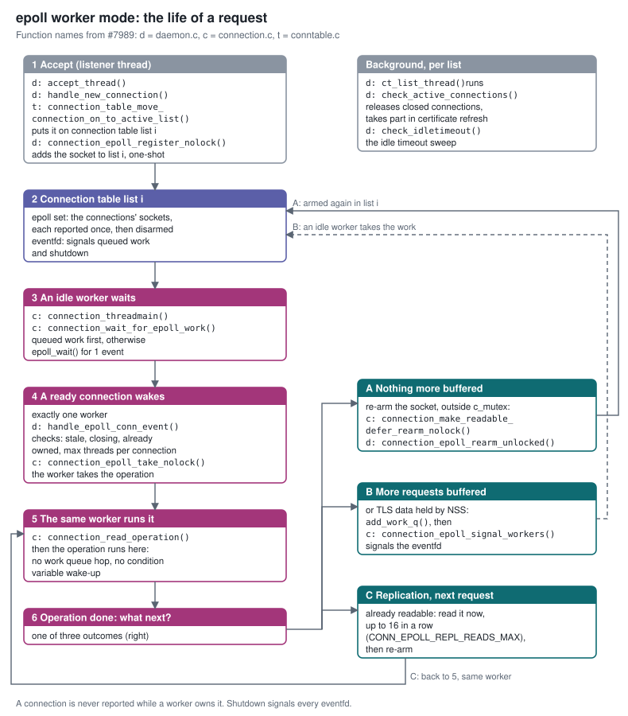

# epoll Worker Mode
-------------------



Overview
--------

Since 3.2 the server can be built with `--enable-epoll`, which replaces the `PR_Poll()` listener with Linux `epoll` ([#6924](https://github.com/389ds/389-ds-base/pull/6924)). Each connection table list still has one listener thread: it waits on the list's epoll instance and hands every ready connection to the worker threads through the global work queue.

Load testing that code showed it was slower than the default poll build at 1,000 connections, and found several correctness problems:

- Level-triggered epoll kept reporting connections that a worker already owned: 3.9 events per operation at 1,000 connections and about 125 at 10,000.
- Closed connections were never released from the active list.
- Each connection had its own timerfd for the idle timeout.
- A TLS connection whose next request was already decrypted inside NSS could stall, because no socket event arrives for it.
- The epoll accept thread did not take part in dynamic certificate refresh, which then hung (`tls/ecdsa_test.py::test_dynamic`).

The fixes for those are in [#7983](https://github.com/389ds/389-ds-base/pull/7983). This document describes the design they lead to, **worker mode** ([#7989](https://github.com/389ds/389-ds-base/pull/7989), issue [#7984](https://github.com/389ds/389-ds-base/issues/7984)): idle worker threads wait on epoll themselves and run the request of the connection that wakes them, so a request no longer passes from a listener thread to a worker. It also explains why worker mode has no turbo mode.

The target is C10k: throughput and latency that do not degrade as the number of connections, busy or idle, grows into the tens of thousands, while staying level with the poll build at small scale.

Use Cases
---------

- **Many concurrent clients.** Application servers and load balancers that keep thousands of LDAP connections open. With the poll build as shipped, throughput collapses at 10,000 active connections (about 1.7k ops/s against 67k at 1,000), mostly because of turbo mode's rank scan (below).
- **Many idle connections.** Connection pools that hold connections open for long periods. Every poll pass walks every open descriptor, so idle connections slow down the active ones.
- **Replication under client load.** A supplier streams changes to a consumer that is also serving a heavy search load; the consumer must keep reading the replication session promptly.

Design
------

### Building blocks (#7983)

These apply in both the epoll listener mode and worker mode.

- **One-shot events.** Connection sockets are registered with `EPOLLONESHOT`, so a ready connection is reported once and then disarmed. The worker that hands the connection back re-arms it (`EPOLL_CTL_MOD`), outside `c_mutex`. A connection is therefore never reported while a worker owns it.
- **No per-connection timerfd.** The existing idle sweep handles idle timeouts, and a timed pass over the active list releases connections that were closed.
- **TLS data held by NSS.** When a request has been read and NSS already holds the next one decrypted (`SSL_DataPending()`), the connection is queued for work directly instead of waiting for a socket event that will not come.
- **Dynamic certificate refresh.** The epoll threads take part in the refresh rendezvous, and shutdown during a refresh is handled.
- **Bounded `epoll_wait()`.** At most 4 events per worker thread (at least 16) are taken per call, so one wake-up cannot grab more ready connections than the workers can run.

### Worker mode (#7989)

- Idle workers wait in `epoll_wait()` on the epoll instance of their connection table list (worker *i* takes list *i* mod `nsslapd-numlisteners`). Because sockets are one-shot, one ready connection wakes one worker.
- The woken worker applies the checks the listener used to apply (stale event, closing connection, already owned, maximum threads per connection), takes the connection's next operation, and reads and runs it. There is no work queue hop, no `work_q_lock` round trip and no condition variable wake-up per request.
- Work that is still queued (more buffered requests, TLS data held by NSS) is signalled through a level-triggered **eventfd** in each list's epoll set. Idle workers take queued work first; a worker that takes the last item clears the eventfd. Shutdown also signals the eventfds, with a 500 ms `epoll_wait()` timeout as a backstop.
- The list threads keep only housekeeping (`check_active_connections()`) and their part in certificate refresh.
- A worker does not act on `EPOLLERR` directly: after waiting for `c_mutex`, the slot may have been closed and reused. It reads, and the read fails on a bad socket.
- **Replication sessions** process one operation at a time. When an operation completes and the supplier's next request is already readable, the same worker reads it straight away, up to 16 in a row, before re-arming the connection so that other connections are not starved.
- Once the server is shutting down, workers read no new requests; queued work is still completed.

### Connection flow

The life of a request in worker mode, with the functions that implement each step (`daemon.c`, `connection.c` and `conntable.c` in #7989):

1. **Accept.** The listener thread (`accept_thread()`) accepts the connection in `handle_new_connection()`. `connection_table_move_connection_on_to_active_list()` puts it on connection table list *i*, and `connection_epoll_register_nolock()` adds its socket to list *i*'s epoll set with `EPOLLONESHOT`.
2. **Connection table list *i*.** Its epoll set holds the connections' sockets, each reported once and then disarmed, plus an eventfd that signals queued work and shutdown.
3. **An idle worker waits.** `connection_threadmain()` calls `connection_wait_for_epoll_work()`, which takes queued work first (`connection_wait_for_new_work()`) and otherwise calls `epoll_wait()` for one event, with a 500 ms timeout.
4. **A ready connection wakes exactly one worker.** `handle_epoll_conn_event()` applies the listener's checks (stale event, closing, already owned, maximum threads per connection), and `connection_epoll_take_nolock()` takes the connection's next operation for this worker.
5. **The same worker reads and runs it.** `connection_read_operation()` reads the request, and the operation runs in this thread: no work queue hop and no condition variable wake-up.
6. **Operation done.** One of three outcomes:
   - **A. Nothing more buffered:** the worker re-arms the socket outside `c_mutex` (`connection_make_readable_defer_rearm_nolock()`, then `connection_epoll_rearm_unlocked()`), and the connection goes back to step 2.
   - **B. More requests already buffered, or TLS data held by NSS:** the work goes on the work queue and `connection_epoll_signal_workers()` signals the eventfd; an idle worker takes it at step 3.
   - **C. Replication session, next request already readable:** the same worker reads it straight away (back to step 5), up to `CONN_EPOLL_REPL_READS_MAX` (16) times in a row, then re-arms.

In the background, each list thread runs `ct_list_thread()`, which calls `check_active_connections()` to release closed connections and takes part in certificate refresh; `check_idletimeout()` handles idle timeouts.

### Why worker mode has no turbo mode

Turbo mode lets a busy connection keep its worker, which then polls that one socket for the next request instead of handing the connection back. Its purpose is to skip the listener-to-worker hand-off. Worker mode removes that hand-off for every connection, so the benefit is gone, while turbo's costs remain:

- Every 5 seconds, each turbo-eligible connection's worker ranks it with `connection_find_our_rank()`, which walks every active connection under the global `table_mutex`. The cost is quadratic in the number of connections. It is the main reason the poll build collapses at 10,000 connections: with turbo turned off, poll holds about 70k ops/s there.
- A turbo worker sits on one socket, in 100 ms polls, instead of serving whichever connection is ready.

The listener mode in #7983 keeps turbo below 2,048 active connections and turns it off above. Worker mode ignores `nsslapd-enable-turbo-mode` and logs that at startup. The one case where reading the same connection again at once still pays, a replication supplier streaming requests, is covered by the next-request read above.

### Alternatives considered

- **One epoll instance for all lists.** Rejected: every per-operation re-arm would contend on that instance's lock. With several lists, a list's ready connections are served only by that list's workers; the default is one list. A possible follow-up is to let idle workers take ready connections from other lists (work stealing), or to rebalance connections between lists periodically.
- **Keep turbo in worker mode, with the 2,048 cut-off.** Measured: worker mode without turbo has lower latency than listener mode with turbo (0.79 ms against 0.92 ms with 1,000 connections open), so turbo would add cost and no benefit.
- **Move operation setup off the listener.** Not needed: the epoll listener uses 0.15 to 0.40 of a core at 10,000 connections, against about 1 core for the poll listener.

Performance
-----------

All measurements use upstream's own tools on a fixed rig: a 16 vCPU / 16 GB Fedora 44 server VM, 10 client VMs running `ldclt` (anonymous base search, closed loop), upstream `ltest.py` for latency, and default server settings. The server is restarted before every job. Throughput and replication results are the mean of two rounds; latency is one 120-sample run. Poll is the standard build as shipped (turbo on unless noted), measured on the same rig in an earlier session.

At 1,000 connections the builds are level. At 10,000, poll falls to about 1.7k ops/s while worker mode holds 67k, 4% below its own 1,000-connection figure. The 65k to 70k ceiling is the same for every build at small scale, so it is the rig's limit rather than the code's. Poll was not measured at 3,000 connections.

With 20,000 connections open, a single client sees 0.83 ms per request in worker mode and about 16 ms with poll, whether or not turbo is on. The cost there is poll's per-pass scan of every descriptor. Worker mode's latency barely changes between 1,000 and 20,000 open connections.

A stock 389ds supplier replicates `dc=repl,dc=test` (150,000 entries) to the test server. Catch-up is the time from the last of 5,000 changes written on the supplier until the consumer has them, while 10,000 client connections search flat out on the consumer. This is a deliberate stress case. Full re-initialisation takes about 600 s on every build.

As shipped, poll needs about 100 s to catch up under this load, and worker mode about 17 s. Poll with turbo off is about 5 s faster than worker mode while serving about 5% fewer searches. Replicated changes are applied by ordinary worker threads, so they share the CPU with the search load.

Other results:
- With 1,000 active and 30,000 idle connections, the #7983 listener mode does 65.8k ops/s; poll does 15.1k with turbo on and 23.3k with turbo off. Worker mode was not measured in this case.
- LDAPS: the #7983 listener mode is level with poll at 1,000 connections; both stall at 10,000 LDAPS connections, a TLS scaling limit shared by both builds.
- An overnight soak (load, connection churn, abrupt client closes, idle timeouts, certificate refresh, replication, restarts under load, 17 cycles) lost no connections.

Major configuration options and enablement
------------------------------------------

- Build: `--enable-epoll` (default: no). All of this code is under `ENABLE_EPOLL`; the default build is unchanged.
- Worker mode: set `SLAPD_EPOLL_WORKERS=1` in the server's environment (for example in the systemd unit's environment file). Without it, the server runs the #7983 listener mode.
- Worker mode is refused, with a warning, if there are fewer worker threads than connection table lists (`nsslapd-threadnumber` < `nsslapd-numlisteners`). An error is logged if fewer workers than lists start.
- `nsslapd-enable-turbo-mode` is ignored in worker mode. In listener mode, turbo is used only up to 2,048 active connections (`SLAPD_EPOLL_TURBO_MAX_CONNS`).

External Impact
---------------

- No schema, configuration attribute or CLI changes.
- Shared connection lifecycle fixes found during this work are separate PRs because they also affect the default build: [#7985](https://github.com/389ds/389-ds-base/pull/7985) (persistent search thread slot), [#7986](https://github.com/389ds/389-ds-base/pull/7986) (worker holding a connection at shutdown), [#7987](https://github.com/389ds/389-ds-base/pull/7987) (unbind during bulk import), [#7988](https://github.com/389ds/389-ds-base/pull/7988) (error logged for buffered requests on a closing connection).
- [#7846](https://github.com/389ds/389-ds-base/pull/7846) (epoll and multiple listener updates) covers some of the same code; how the two combine is discussed in [#7842](https://github.com/389ds/389-ds-base/issues/7842).
- Tests: `dirsrvtests/tests/suites/threads/connection_handling_test.py` covers five close paths under load and requests buffered in one TLS record. The connection handling, persistent search and replication acceptance suites pass in both modes.

Origin
------

- [#7982](https://github.com/389ds/389-ds-base/issues/7982) / [#7983](https://github.com/389ds/389-ds-base/pull/7983): epoll connection listener performance and correctness
- [#7984](https://github.com/389ds/389-ds-base/issues/7984) / [#7989](https://github.com/389ds/389-ds-base/pull/7989): let idle worker threads wait on epoll directly
- [#7842](https://github.com/389ds/389-ds-base/issues/7842): epoll design discussion
- [#6924](https://github.com/389ds/389-ds-base/pull/6924): migrate from PR_Poll to epoll

Author
------

Larry Lile (@lslile)

Assisted by: Claude (analysis, test harness, drafting) and Codex (adversarial review of every change); the design decisions, testing and conclusions were reviewed by the author.
